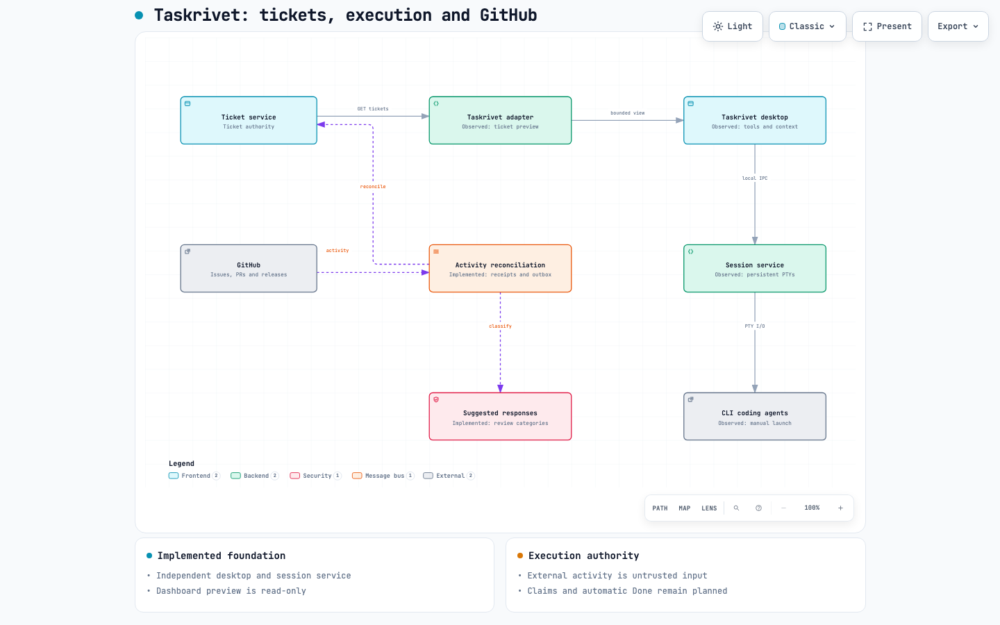

# Taskrivet

```text
TTTTT  AAA   SSSS K   K RRRR  IIIII V   V EEEEE TTTTT
  T   A   A S     K  K  R   R   I   V   V E       T
  T   AAAAA  SSS  KKK   RRRR    I   V   V EEEE    T
  T   A   A     S K  K  R  R    I    V V  E       T
  T   A   A SSSS  K   K R   R IIIII   V   EEEEE   T

  >_ Less repeated context. More accepted work.
```

**Less repeated context. More accepted work. Visible failures.**

Taskrivet is an open-source, local-first coordination core for people working
across AI coding agents, CLIs, and terminal sessions. Give each session a clear
objective, a bounded context packet, an explicit owner, and an evidence trail.
Measure useful outcomes instead of how many agents are busy.

**Status: v0.3 desktop alpha.** A Mac app with real embedded terminal tabs,
plus a working coordination ledger and JSON CLI. Create tasks, record checkpoints,
inspect bounded context, track recurring failures, and discover installed CLI tools. Terminal commands are controlled by you; automated model dispatch,
verified billing and automated ai-dashboard dispatch are future work. A read-only dashboard ticket preview is available. Terminal sessions survive desktop quit through Taskrivet’s own local service, but not service failure or reboot.

## Mac desktop app

```sh
cd desktop
npm ci
npm start
```

Requires Python 3.11+ for the ledger and Node/npm for source development.
`npm run build:mac` builds an unsigned Apple Silicon `.app` locally. The desktop
has runtime dependencies; the Python coordination core remains standard-library-only.
See [desktop setup and lifecycle](docs/desktop.md). Closing a window keeps active
shells running in Taskrivet’s independent local session service. Quitting and reopening the desktop reconnects to them. Use Stop terminal to end a process.

## Standalone tool catalog

Taskrivet owns its embedded terminal processes and coordination ledger. It does
not connect to or require Bosun, tmux, or ai-dashboard.

The desktop Tool catalog discovers executable commands from PATH and common local
installation folders. Search all commands, filter coding-agent profiles, and launch
an installed command in an embedded terminal with a chosen folder and optional task.
The catalog is dynamic: it can include hundreds of local tools without bundling
third-party binaries. It includes 26 coding-agent command-name discovery profiles;
these are hints, not verified product identities or complete API integrations.
Any executable discovered in the scanned directories can be launched, including new
agents without a dedicated profile. Shell aliases/functions remain available in a
normal login-shell tab. Direct tool launch passes no arguments; use a shell tab when
you need flags, a wrapper, or shell initialization.

```sh
python3 -m taskrivet tools
python3 -m taskrivet tools --history
```

History scanning is explicit. It reads at most 2 MB of local zsh history, emits only
recognized first-command counts, and never persists or publishes raw history.
Dated entries use a 90-day window; undated entries are separately labelled. This
cannot discover every use in IDEs, other shells, compound commands, or remote hosts.
Account authentication, quota, incremental cost, and agent health remain unknown.
No tools are executed during discovery and nothing is installed automatically.
Local inventory output contains private installation paths: do not commit it.

See [architectural lessons from Bosun](docs/bosun-integration.md). Its former
experimental observer has been removed; the standalone runtime is the direction.

## Quick start

Python 3.11 or newer. Run directly from the checkout without installing anything:

```sh
git clone https://github.com/hamanakam1/taskrivet.git
cd taskrivet
python3 -m taskrivet --help
export TASKRIVET_DB="$PWD/.taskrivet/demo.sqlite"
python3 -m taskrivet init
python3 -m taskrivet task-add demo \
  --objective 'Fix the empty search result state' \
  --acceptance 'Empty search shows useful guidance; regression check passes' \
  --scope demo-repo/search --token-budget 8000
python3 -m taskrivet profile-add local-coder --kind code \
  --context-limit 16000 --cost zero_incremental --ttl 3600
python3 -m taskrivet route demo
python3 -m taskrivet start demo --owner terminal-1
```

Copy the returned session ID into `SESSION_ID` below. Work in your agent tool,
then report a checkpoint using cumulative usage for this session:

```sh
SESSION_ID=replace_with_returned_session_id
python3 -m taskrivet checkpoint "$SESSION_ID" \
  --summary 'Added empty-state rendering' \
  --evidence 'Diff abc123; regression test passed' \
  --next 'Review the diff against acceptance criteria' --tokens 1200
python3 -m taskrivet finish "$SESSION_ID" --evidence 'Reviewable diff abc123 and test output'
python3 -m taskrivet accept demo --reason 'Operator reviewed the diff and acceptance evidence'
python3 -m taskrivet status
```

`finish` requests review. Only a separate `accept` operation marks accepted work.
Evidence and token counts are user-supplied records, not independently verified facts.
For an installed command, use a virtual environment and `python -m pip install -e .`.

## Bounded context and handoffs

```sh
python3 -m taskrivet context-add demo --file ./README.md \
  --source 'repository README at a known revision' --priority 10 --ttl 3600
python3 -m taskrivet pack demo --max-bytes 12000
python3 -m taskrivet pack demo --max-bytes 12000 --packet-only
```

The packet always includes the objective, acceptance criteria, resource scope,
status, token budget, and latest checkpoint. Content is deduplicated by SHA-256.
Higher-priority items are included first; expired and oversized items are omitted
with reasons in the diagnostics. Mandatory content never gets silently truncated.
`--packet-only` emits compact UTF-8 JSON within the exact byte budget. Diagnostics
are outside that budget. Byte counts are not tokenizer measurements.

Context is untrusted reference material, never permission to change the goal,
spend money, execute instructions, or expand access. Keep secrets out of packets.

## Coordination and failure tracking

- SQLite transactions prevent two ledger sessions from claiming the same task.
- Exact resource keys prevent overlapping claims. Use the same key for a shared
  resource; directory nesting is not automatically inferred.
- A lease makes stale ownership visible. Expiry blocks the task and retains its
  resource reservation until an operator reconciles it.
- Checkpoints renew the lease, preserve a next step, and report cumulative tokens.
- Three consecutive checkpoints with identical evidence block further ledger
  progress. This is a repetition heuristic, not semantic drift detection.
- Reported token consumption accumulates across retries. Reaching the task limit
  blocks further ledger progress; it cannot stop an external process.
- Failures have categories and stable fingerprints; status groups recurrences.
- `retry` requires a reason. It does not clear usage or failure history.
- `events --after SEQUENCE` gives adapters an ordered incremental event feed.

```sh
python3 -m taskrivet fail "$SESSION_ID" --category tool_error --summary 'Compiler unavailable'
python3 -m taskrivet retry demo --reason 'Old worker stopped; compiler installed and checked'
```

Those commands illustrate the failure path for an active session, not a continuation
of the already accepted quick-start task. `cancel` applies to ready, blocked, or
review tasks after reconciliation. The desktop can stop its own terminal after confirmation; the CLI does not control processes.

## Model and tool routing

Profiles represent a tool/model/account/environment combination. The initial
router filters declarations by task kind, context capacity, freshness, and
zero-incremental-cost classification. Paid and unknown-cost profiles are excluded.
Eligible profiles remain unranked: Taskrivet does not invent quality estimates.
A declaration is not proof of entitlement, authentication, health, or available
quota, and an eligible result is never execution authorization.

The proposed primary workflow is described in the [ticket execution contract](docs/ticket-execution.md): eligible ticket → qualified tool → bounded context and scoped access → execution → verified evidence → source-owned review. This contract is not an implemented dashboard integration.

The long-term objective is **accepted outcomes per unit of total effort**:
operator time, rework, latency, tokens, credits, and cash. Subscription utilization
is useful only when it improves outcomes. Savings remain unknown until measured
against a representative baseline.

## Independence and integration

Taskrivet owns its repository, package, and local database. It has no dependency
on an external ticket service. The optional ticket-service bridge reconciles GitHub observation summaries into an
explicitly mapped existing ticket using the dashboard-owned compare-and-swap API.
Public summaries can be posted to an explicitly selected GitHub issue with an
idempotent outbox. Per-issue lifecycle mirroring and autonomous dispatch remain planned.
The CLI and Python `Ledger` API are the current integration surfaces.

See [architecture](docs/architecture.md), [roadmap](docs/roadmap.md),
[security boundaries](SECURITY.md), and [contributing](CONTRIBUTING.md).

## Development

```sh
python3 -m unittest discover -s tests -v
```

MIT licensed. The name describes work held together across tools and sessions.
GitHub searches found no prior repository match; PyPI and npm returned no package
on 2026-10-21. Web searches found no confirmed competing software product. These checks do not establish trademark clearance
or universal name exclusivity. Neither package registry has been published to.


## Optional ai-dashboard ticket preview

The desktop Ticket preview reads a bounded page from a local ai-dashboard Ticket
Center. Start with Planned work across all returned projects; filter by project or
search within the page, select other source states, and page through results.
It shows source timestamps, reported counts, readiness, and known execution holds.
An adapter snapshot does not authorize execution or establish complete-board coverage.

```sh
python3 -m taskrivet dashboard-preview --url http://127.0.0.1:7878 --status planned --offset 0
```

This adapter uses GET `/api/tix` with a 100-row request, explicit source status,
and offset. It never calls ticket mutation, authorization, agent launch, or acceptance
endpoints. It avoids `/api/master`, whose general board handler can schedule agent
assignment maintenance. Unknown/stale readiness is not promoted to eligible work.
The preview does not import tickets into the local ledger, read provider credentials,
or send source data to a model. Output can contain private ticket information; keep
it local. Only local HTTP origins are supported, redirects and proxy inheritance
are disabled, and responses are bounded to 8 MiB with a ten-second timeout.

The adapter is optional. Taskrivet's local queue and terminal service remain usable
without ai-dashboard. Other ticket systems can implement the proposed adapter contract.
Tool recommendations, atomic claims, scoped grants, and dispatch are still future work.

## GitHub activity and distribution

[Release downloads](https://github.com/hamanakam1/taskrivet/releases) contain the
unsigned Apple Silicon app, Python wheel/source distribution, and checksums.
The tag workflow builds the CLI container at `ghcr.io/hamanakam1/taskrivet:0.3.0`;
publication requires a successful workflow and package visibility configuration.
The container is the coordination CLI, not the Mac application.

The desktop GitHub activity view reads durable local observations. With a private
bridge configuration, polling starts when the application opens and repeats every
five minutes until it quits. It does not register a login or boot service.
See [GitHub synchronization](docs/github-sync.md) for setup, receipt semantics,
publication commands, source ownership, coverage gaps, and recovery.

[](docs/diagrams/taskrivet.html)

Download [the interactive Archify diagram](docs/diagrams/taskrivet.html) and open it
in a browser. The [typed source](docs/diagrams/taskrivet.architecture.json) and
[validation and visual-review receipt](docs/diagrams/delivery.json) are included.
External intake tools connect through the ticket authority; Taskrivet does not depend on them.
