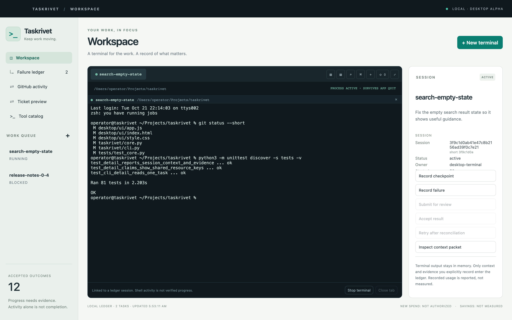

# Taskrivet

**A local-first workspace for AI coding agents and ticket work.**

Keep persistent terminals, a clear objective, bounded context, and reviewable evidence together. Spend less time repeating context and more time finishing useful work.

[](https://github.com/hamanakam1/taskrivet/actions/workflows/tests.yml)
[](https://github.com/hamanakam1/taskrivet/actions/workflows/public-content-privacy.yml)
[](https://github.com/hamanakam1/taskrivet/releases)
[](pyproject.toml)
[](LICENSE)

[Interactive guide](https://hamanakam1.github.io/taskrivet/) · [Downloads](https://github.com/hamanakam1/taskrivet/releases) · [Roadmap](docs/roadmap.md) · [Discussions](https://github.com/hamanakam1/taskrivet/discussions) · [Contribute](CONTRIBUTING.md)



*The workspace above uses synthetic data. It shows the interface, not a completed real ticket.*

## What you can do today

- **Keep agents in view.** Open real terminal tabs, split panes, find text in scrollback, and reconnect after closing the desktop. Resume local OpenCode sessions in separate tabs.
- **Carry focused context.** Give a task an objective, acceptance criteria, resource scope, token budget, and a bounded context packet with freshness and provenance.
- **Follow one ticket through a session.** Choose a ticket and an installed agent, launch a supervised attempt, record progress, and preview a report before sending it through your configured adapter.
- **Keep evidence and failures visible.** Inspect checkpoints, leases, self-reported usage, repeated failures, and the ordered ledger events.
- **Observe GitHub activity.** Reconcile bounded observations of issues, PRs, reviews, commits, Actions and releases. Publish only an explicitly selected public summary through the idempotent outbox.

**Status: desktop alpha.** The released Mac application is unsigned and unnotarized. The core works independently of any external ticket service. Automated ticket selection, verified model/provider routing, source claims, process isolation, reboot recovery, and autonomous acceptance remain proposed work. See the [execution contract](docs/ticket-execution.md) and [security boundaries](SECURITY.md).

An optional [source-owner execution client](docs/owner-execution.md) prepares one explicit request for a separately configured local owner, binds exact source and control revisions, and reconciles its durable receipt. Its supported inference policy prohibits paid or unknown entitlement. Bounded observation follows that one request; it does not select more tickets or establish accepted work.

## Start here

| Your goal | Start with |
| --- | --- |
| Try the Mac application | [Release downloads and checksums](https://github.com/hamanakam1/taskrivet/releases), then [desktop setup](docs/desktop.md) |
| Use the standalone Python CLI | The quick start below; Python 3.11+, no runtime dependencies |
| Work a ticket with an agent | [Supervised ticket loop](docs/ticket-loop.md) |
| Connect GitHub activity | [GitHub synchronization guide](docs/github-sync.md) |
| Understand the design | [Interactive guide](https://hamanakam1.github.io/taskrivet/), [architecture](docs/architecture.md), [long-term plan](docs/long-term-plan.md) |
| Ask a question or propose an idea | [Discussions](https://github.com/hamanakam1/taskrivet/discussions) |
| Report a reproducible defect | [Bug report](https://github.com/hamanakam1/taskrivet/issues/new?template=bug_report.yml) |

Releases contain an Apple Silicon app, Python wheel/source distribution, and `SHA256SUMS`. Download the assets from the same release and verify them with `shasum -a 256 -c SHA256SUMS`. Read the release notes for that version's requirements and validation; source branches may contain newer development work.

### Python CLI

```sh
git clone https://github.com/hamanakam1/taskrivet.git
cd taskrivet
python3 -m taskrivet --help

# Keep the demo ledger separate from your normal tasks.
export TASKRIVET_DB="$PWD/.taskrivet/demo.sqlite"
python3 -m taskrivet init
python3 -m taskrivet task-add demo \
  --objective 'Fix the empty search result state' \
  --acceptance 'Empty search shows useful guidance; regression check passes' \
  --scope demo-repo/search --token-budget 8000
python3 -m taskrivet start demo --owner terminal-1
```

Use the returned session ID to record the work you perform in your agent tool:

```sh
SESSION_ID=replace_with_returned_session_id
python3 -m taskrivet checkpoint "$SESSION_ID" \
  --summary 'Added empty-state rendering' \
  --evidence 'Reviewable diff and regression-test output' \
  --next 'Review against acceptance criteria' --tokens 1200
python3 -m taskrivet finish "$SESSION_ID" --evidence 'Diff and test output ready for review'
python3 -m taskrivet accept demo --reason 'Operator reviewed the acceptance evidence'
python3 -m taskrivet status
```

`finish` requests review. A separate `accept` decision records acceptance. Evidence and token counts are supplied records, not independently verified facts or measured billing. For an installed `taskrivet` command, create a virtual environment and run `python -m pip install -e .`.

### Mac workspace from source

```sh
cd desktop
npm ci
npm start
```

The Electron workspace requires Python 3.11+ and Node/npm for source development. `npm run build:mac` builds an unsigned Apple Silicon app. [Desktop setup](docs/desktop.md) explains terminal lifecycle and packaging.

Shortcuts: `⌘T` new tab, `⌘D` split right, `⇧⌘D` split down, `⌘F` find, `⌘K` command palette, `⌘W` close pane, `⌘1`–`⌘9` switch tab, `⇧⌘F` focus mode. A second pane can join the same ledger session without claiming a second lease.

A native SwiftUI workspace is available in [`macos/`](macos/). It covers the ticket loop, task inspector, terminal tabs, and read-only routing observations; the Electron workspace remains the reference until the native app reaches parity. See [native Mac setup](docs/macos.md) for developer builds and [routing observations](docs/routing.md) for source freshness, candidates, and holds. These observations do not authorize dispatch or establish a verified model recommendation.

### Supervised ticket work

Configure an optional local ticket service and choose the ticket and agent yourself. This origin is a synthetic example; there is no default destination.

```sh
python3 -m taskrivet config set ticket_service.origin http://127.0.0.1:8080
python3 -m taskrivet --format table tickets --limit 20
python3 -m taskrivet --format table ticket DEMO-42
python3 -m taskrivet work DEMO-42 --tool codex --dry-run
```

Review the plan and any holds before launching. The [ticket loop guide](docs/ticket-loop.md) covers hold acknowledgement, agent launchers, attachment, and confirmed handback. Acknowledgement does not clear a hold or authorize unattended work. This supervised terminal loop does not claim or change the source ticket's stage, tags, or acceptance.

## How the boundaries work

| Taskrivet records or enforces locally | What that does not establish |
| --- | --- |
| Exclusive ledger task and exact resource-key leases | A filesystem sandbox or an external source claim |
| Bounded context, provenance, expiry and content hashes | Permission to execute instructions inside that context |
| Declared profile compatibility and zero-incremental-cost filtering | Authentication, quota, measured quality or best-model selection |
| Checkpoints, cumulative reported tokens and failure fingerprints | Measured billing or automatic termination of an external process |
| Finished sessions and explicit operator acceptance | Accepted completion in an external ticket system |
| Terminal reconnection after desktop quit | Recovery after session-service failure or reboot |

Terminal commands run with your normal permissions and may use your existing provider accounts. Discovery does not execute tools or copy credentials. The optional history scan emits recognized command counts, not raw shell history. Read [SECURITY.md](SECURITY.md) before connecting real work.

## Build with us

The [roadmap](docs/roadmap.md) identifies the next integration contracts and links to existing issues. A roadmap issue is a proposal until its scope, acceptance checks, and prerequisites are reviewed; the generated backlog is not an executable queue.

- Ask questions and compare ideas in [Discussions](https://github.com/hamanakam1/taskrivet/discussions).
- Use [issue forms](https://github.com/hamanakam1/taskrivet/issues/new/choose) for reproducible bugs and scoped changes.
- Follow [CONTRIBUTING.md](CONTRIBUTING.md) for local checks, PR evidence, and privacy review.
- Report security vulnerabilities through [private reporting](https://github.com/hamanakam1/taskrivet/security/advisories/new), not a public issue.
- See [support](SUPPORT.md) and the [code of conduct](CODE_OF_CONDUCT.md).

```sh
python3 -m unittest discover -s tests -v
cd desktop
npm ci
npm test
```

MIT licensed. No provider service, third-party coding agent, or subscription is bundled.
