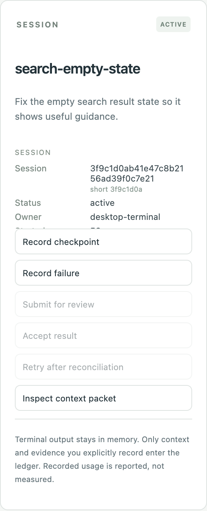
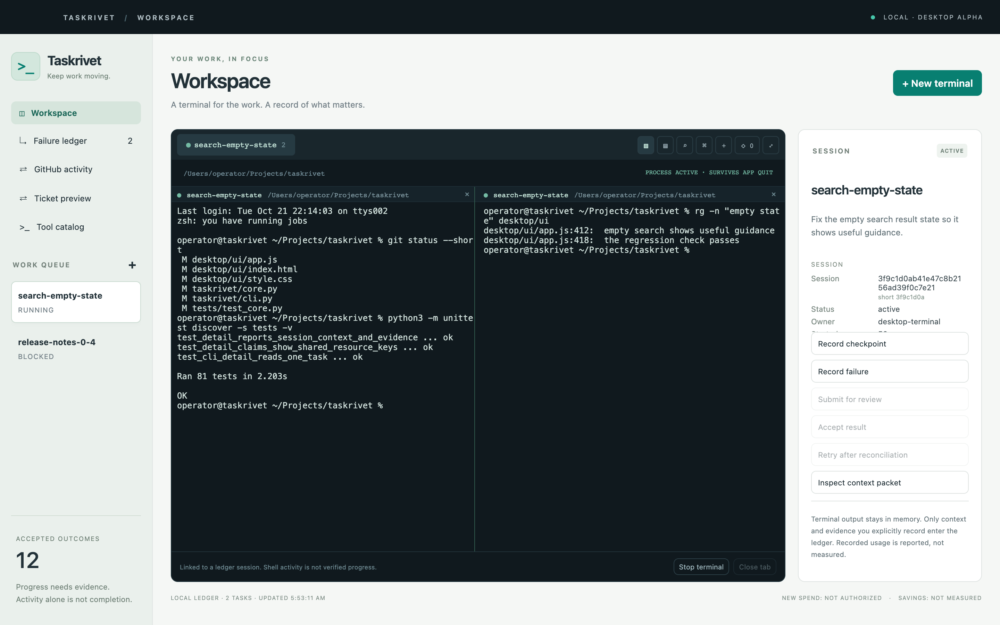

# Mac desktop alpha

Taskrivet Desktop embeds xterm.js terminals backed by node-pty and connects to the
Python coordination ledger over a narrow Electron IPC bridge. It has task creation,
task-linked terminal tabs, checkpoints, failure records, review and acceptance,
context inspection, and a searchable local tool catalog.

## Run and build

Requires macOS on Apple Silicon, Python 3.11+, and Node/npm for source development.
The packaged app includes its JavaScript runtime and Python sources, but still needs
an existing Python 3.11+ installation for the ledger. It checks common Python paths.
Terminals do not require Python. This dependency is a packaging limitation of the alpha.

```sh
cd desktop
npm ci
npm start
npm test
npm run build:mac
```

The local build is `desktop/dist/mac-arm64/Taskrivet.app`. It is unsigned and not
notarized; it is a developer build, not a signed public Mac distribution. No signing
identity is acquired and no Apple enrollment is purchased by these commands.

## Lifecycle and authority

Nothing opens a shell until the user chooses New terminal and submits its form.
The selected working folder must exist. Shells inherit the user's environment and
login startup files. They run with the user's normal permissions and are not sandboxed.
A program launched manually in a shell can incur charges; the ledger's routing policy
does not intercept manual terminal commands or enforce provider budgets.

Task-linked terminals claim a ready ledger task. The lease is renewed by a checkpoint,
not by output or a busy indicator. Expiry or budget limits block ledger progress;
they do not terminate a manually controlled shell. The inspector shows the task state.
The task's exact scope keys do not restrict filesystem access.

Closing or quitting the desktop leaves terminal processes in the Taskrivet session
service. Reopening reconnects to them. Use Stop terminal to end a process.
Detached child processes may remain and require separate reconciliation.

A shell exit does not finish or accept a task. Stop the linked terminal before
submitting its result for review, accepting, or retrying. Checkpoints and failure
records are explicit operator entries, not automated evidence verification.

## Privacy and UI boundary

All frontend assets are local. The renderer uses sandboxing, context isolation,
no Node integration, denied navigation/new windows, and a restrictive CSP. IPC
checks the originating main frame and exposes explicit operations rather than a
generic shell command API. Python is invoked with an argument vector, never a shell.

Terminal output is buffered only in memory with bounded retained history. OSC 52
clipboard writes are intercepted; hyperlinks do not automatically open external
content. Terminal programs still have the same filesystem/network access as other
programs run by the user. Do not paste secrets into recorded context or evidence.

## Session inspector

The right-hand column is the record for the focused pane. It reads one ledger
view per task: the session record (identifier, owner, status, lease time
remaining, reported tokens), the task (objective, acceptance criteria, kind,
resource scope keys, budget against reported usage, and any other task holding
the same keys), the bounded context packet (size, attached items, omitted items
and the reason), every checkpoint with its evidence and next step, recorded
failures with their recurrence counts, and the ledger event trail.

The panel follows the focused pane, so a split layout shows the record of the
pane being worked in. The read is a local `taskrivet detail` call: it writes
nothing and claims nothing. Recorded usage, recorded evidence, and context
source labels are operator-supplied records, not measured cost, not verified
evidence, and not authority.



## Terminal features

Panes split right or down (Command-D, Command-Shift-D). A split of a
task-linked pane joins the existing ledger session rather than claiming a new
one: the attempt and its lease stay shared, and the second pane is refused when
that session is no longer active. Tabs can be renamed, closed, and closed in
bulk from the context menu.

Find (Command-F) searches the focused pane's scrollback, including text that
wrapped across lines, and jumps between matches. The command palette
(Command-K) exposes the same actions as the buttons. The shell's own folder is
shown when the shell reports it with OSC 7; otherwise the launch folder is
shown. Command-C copies a selection when there is one and otherwise reaches
the shell unchanged.



## Screenshots

`desktop/scripts/capture-screenshots.mjs` renders the real workspace renderer in
a browser against a synthetic bridge, asserts that the inspector shows the
expected records, and writes the images in `docs/screenshots`. It never starts a
shell, reads a ledger, or contacts a network service.

```sh
cd desktop
npm ci
npx playwright install chromium
node scripts/capture-screenshots.mjs
```

## One tab per OpenCode session

The terminal card header carries an OpenCode drawer. It asks the local OpenCode CLI
for the session list and shows each session as a row: title, working folder, last
update, and identifier. Opening a row starts `opencode --session <id>` in that
session's own folder as a dedicated Taskrivet tab. The session is resumed, not copied;
its history and context stay with it.

`Open each as a tab` opens every matching session that is not already open, in
separate tabs. It confirms the count first, opens at most twelve per action, and
reports how many started and how many failed. The session service holds twenty-four
tabs at once.

What is read: identifier, title, working folder, agent, model, and timestamps, through
the OpenCode CLI with an explicit argument vector. What is not read: transcripts,
messages, credentials, provider settings, and the OpenCode database. Nothing is
written back to OpenCode. A folder that no longer exists is labelled and cannot be
opened. The list is a local observation, not a complete inventory: sessions held by
another account, another machine, or a remote host are not visible, and a session
that another process is actively using is shared rather than isolated.

A resumed OpenCode session in a tab is a live agent process with the user's normal
permissions. Opening many of them starts many processes at once. Opening a session
that is already running elsewhere shows the same conversation in two places.

## Terminal focus

The ⤢ button collapses the navigation: sidebar, heading, inspector, status strip, and
title bar are hidden, and the terminal card takes the whole window. This is not macOS
fullscreen. The window keeps its own size and position, the tab bar stays reachable,
and the traffic lights stay clear of the first tab. Command-Shift-F toggles the mode,
and the choice is remembered locally for the next launch. The terminal is fitted to
the new space when the mode changes.

## Verification

- Unit tests cover coordination, protocol parsing, IPC argument validation and bounds.
- Packaged Apple Silicon app was launched and visually reviewed on a Mac.
- Real embedded PTY input produced expected output in `/tmp`.
- Shell input/output remained functional after closing and reopening the window.
- Automated service test preserves the same shell PID and output across client disconnect/reconnect.
- The renderer is exercised in a browser against a synthetic bridge: the session
  inspector, split panes, find, and the command palette are asserted before the
  screenshots in `docs/screenshots` are written.
- No live AI provider/TUI compatibility was qualified.

At initial dependency review, `npm audit --omit=dev` reported no vulnerabilities.
The build dependency chain had a moderate `sprintf-js` advisory with no patched
upstream version available. It is not in the packaged runtime dependency tree.
Do not describe this alpha as security-audited or ready for untrusted clients.


## Current standalone session lifecycle

Taskrivet now starts its own detached Electron-as-Node session service on demand.
The service, not the window, owns node-pty processes. Closing or quitting the desktop
leaves these processes running. On launch, the desktop authenticates to a private
Unix socket and restores terminal IDs, process IDs, task links, exit states, and a
bounded output tail. Use Stop terminal to end work; Close tab removes exited records.

There is no Bosun/tmux
backend, launchd registration, reboot persistence, or automatic command replay.
The service must remain alive. Its output buffer is not a complete transcript or a
terminal-screen serialization; long-running TUIs may require a redraw after attach.
Task ownership leases still expire normally; process survival does not renew a lease
or prove progress. The service uses the environment it inherited when started.

A startup lock serializes service creation. If the desktop crashes during service
startup, an orphaned `starting` directory can block future starts; reconcile process
and socket state before removing it. A disconnected client reports unknown outcomes
instead of automatically retrying commands. Reopen the app to reconcile sessions.
